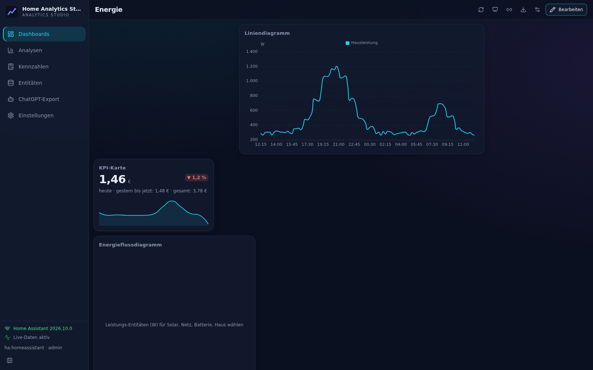
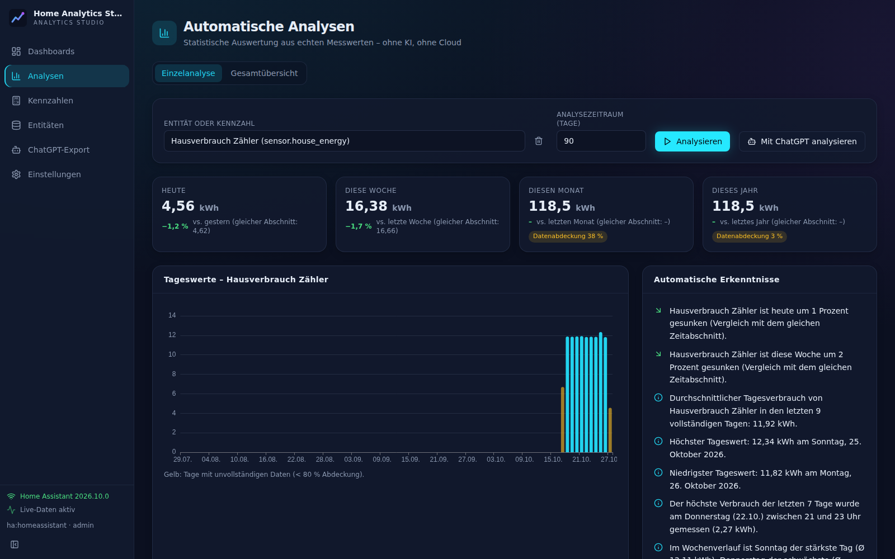
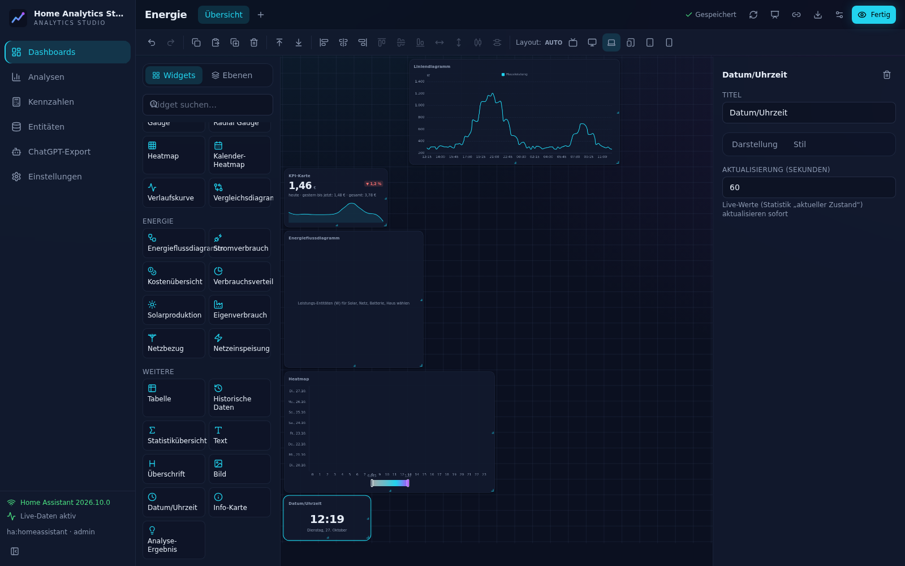
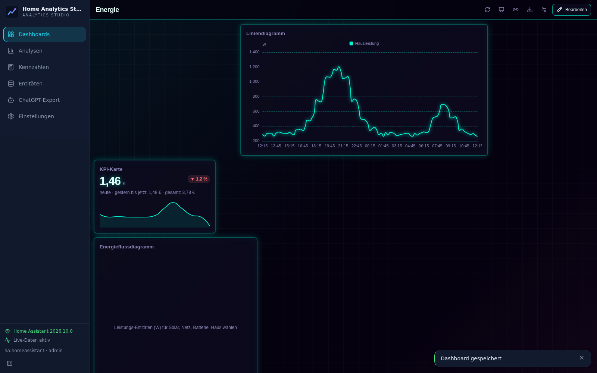

# Home Analytics Studio

Eigenständiges Analyse- und Visualisierungssystem für Home Assistant – als Add-on installierbar.

Home Assistant ist ausschließlich **Datenquelle** (nur lesender Zugriff, keine Gerätesteuerung). Das Add-on bringt
eine eigene Weboberfläche, eine eigene Langzeitdatenbank, einen visuellen Dashboard-Editor, einen Formel-Editor
für berechnete Kennzahlen, automatische statistische Analysen, einen ChatGPT-Export, einen Präsentationsmodus
sowie Backup- und Exportfunktionen mit. Es funktioniert vollständig lokal, ohne Cloud und ohne API-Keys.

| Dashboard | Analysen |
|---|---|
|  |  |
|  |  |

## Funktionen (Kurzüberblick)

- **Langzeitdatenbank** (SQLite, WAL): Rohwerte + automatische Verdichtung (5 min / 1 h), Aufbewahrung je Stufe und Entität,
  Speicherüberwachung, Integritätsprüfung, korrekte Behandlung von Zählerständen, Resets, Lücken, Duplikaten,
  Einheiten, Zeitzonen und Sommerzeit
- **Import** von HA-Historie und Langzeitstatistiken; automatisches Nachladen nach Verbindungsabbrüchen
- **Entitätenverwaltung**: Suche, Filter, Gruppierung nach Bereich/Gerät, Mehrfachauswahl, Speicherbedarf, letzter Datenpunkt
- **Formel-Editor** (visuell + Text) mit sicherem eigenem Interpreter, Validierung, Einheitenprüfung, rückwirkender Berechnung
- **Analyse-Engine**: Vergleiche Tag/Woche/Monat/Jahr, Trends, Spitzen, Auffälligkeiten, Profile – ohne KI
- **Dashboard-Builder**: Drag & Drop, Größenänderung, Ebenen, Ausrichtung, Undo/Redo, Copy/Paste, Autosave,
  responsive Layouts (Smartphone bis TV), mehrere Seiten, 38 Widget-Typen (inkl. animierter Szenen: Haus mit Solaranlage, Wärmepumpe, eigener HTML/CSS-Code)
- **Design**: 7 Presets (Modern Minimal, Dark Analytics, Futuristic Neon, Glass Dashboard, Energy Control Center, …), alles anpassbar
- **ChatGPT-Export** (Prompt/Markdown/JSON, manuelle Übergabe) + optionale Ollama/OpenAI-kompatible Anbieter
- **Präsentations-/Kioskmodus** mit schreibgeschützten Links
- **Zugriff** über HA-Ingress und direkten Port (`http://<HA-IP>:8100`) mit Benutzeranmeldung und Rollen
- **Backups** mit Prüfsummen, Wiederherstellung, Integration in HA-Backups; CSV/JSON-Export

Das vollständige Benutzerhandbuch steht in [`home_analytics_studio/DOCS.md`](home_analytics_studio/DOCS.md)
(wird in Home Assistant im Add-on-Tab „Dokumentation“ angezeigt).

## Installation

### Über das Add-on-Repository (empfohlen)

1. Home Assistant → **Einstellungen → Add-ons → Add-on Store** → Menü ⋮ → **Repositories**.
2. Repository-URL hinzufügen: `https://github.com/pquandel2-alt/home-analytics-studio`
3. **Home Analytics Studio** auswählen → **Installieren** (das Image wird lokal gebaut, ca. 1–3 Minuten;
   es wird kein Node.js benötigt, die Oberfläche ist vorgebaut).
4. Optional „In Seitenleiste anzeigen“ aktivieren → **Starten** → **Benutzeroberfläche öffnen**.
5. Für den Direktzugriff: In der Oberfläche unter *Einstellungen → Benutzer und Sicherheit* einen Benutzer anlegen und
   `http://<HA-IP>:8100` aufrufen.

Unterstützte Architekturen: `amd64`, `aarch64` (z. B. Raspberry Pi 4/5, Home Assistant Green/Yellow).

### Lokale Installation (ohne GitHub)

Den Ordner `home_analytics_studio/` per Samba/SSH nach `/addons/home_analytics_studio/` auf den HA-Host kopieren,
im Add-on Store ⋮ → **Nach Updates suchen**; das Add-on erscheint unter „Lokale Add-ons“.

### Update-Konzept

- Versionsnummer in `home_analytics_studio/config.yaml` erhöhen und `CHANGELOG.md` ergänzen; Home Assistant bietet das Update an.
- Datenbankänderungen erfolgen ausschließlich über versionierte Migrationen (`backend/has/db.py`), die beim Start automatisch
  und idempotent laufen. Ein Downgrade auf eine ältere Version mit neuerem Schema wird erkannt und verweigert.
- Vor einem Update erstellt Home Assistant (optional) ein Add-on-Backup; zusätzlich gibt es die täglichen automatischen Sicherungen
  des Add-ons.
- Optional können vorgebaute Images (GitHub Container Registry) veröffentlicht und in `config.yaml` per `image:` eingetragen werden;
  derzeit wird lokal gebaut.

## Entwicklung

```bash
# Backend
python3 -m venv .venv && .venv/bin/pip install -r home_analytics_studio/backend/requirements.txt -r requirements-dev.txt
cd home_analytics_studio/backend && ../../.venv/bin/python -m pytest

# Frontend
cd home_analytics_studio/frontend && npm ci && npm test && npm run build

# Komplette Umgebung mit Home-Assistant-Simulator (Testdaten) starten
VENV=$PWD/.venv scripts/dev-run.sh      # UI: http://localhost:18099
# Browser-End-to-End-Test (Playwright, benötigt laufende dev-run.sh)
.venv/bin/python home_analytics_studio/backend/tests/e2e/ui_smoke.py http://localhost:18099 /tmp/shots

# Add-on-Image bauen
scripts/release-check.sh               # Tests + Frontend-Build + docker build
```

Weitere Dokumentation: [Technische Dokumentation](docs/TECHNICAL.md) · [Tests & Ergebnisse](docs/TESTING.md) ·
[Entwicklungsstatus](DEVELOPMENT_STATUS.md)

## Lizenz

MIT – siehe [LICENSE](LICENSE).
